# LAST STOP: NIGHT SHIFT: plan și implementare (versiunea 2D)

> **Sursa:** `Last_Stop_Night_Shift_Adaptat_Temei_POO.docx` (concept adaptat temei POO).
> **Rezultat:** joc 2D pixel-art în Windows Forms (.NET 10) construit pe povești interactive cu blocuri narative.
> Are **3 povești** jucabile, asseturi originale, un Player, un Editor și arhive ZIP `story.json + images/`.

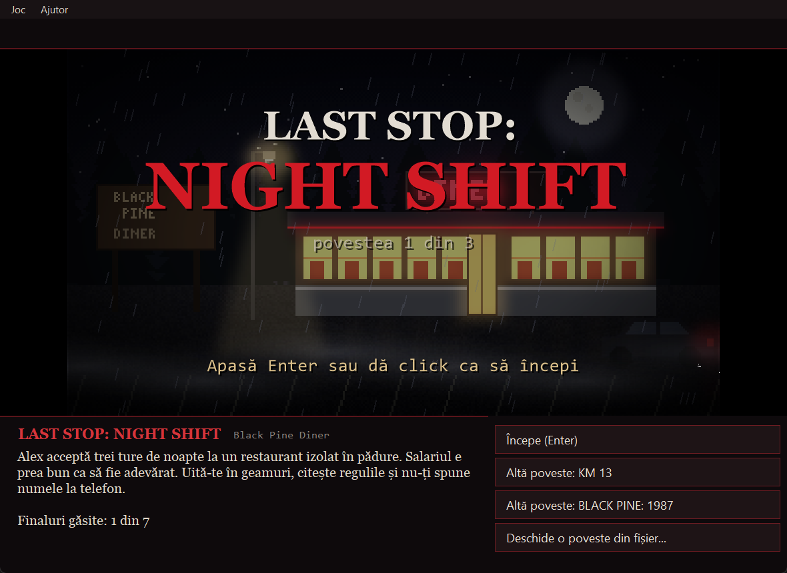

---

## Cuprins
1. [Plan: decizii de proiectare](#1-plan-decizii-de-proiectare)
2. [Plan: arhitectură](#2-plan-arhitectură)
3. [Plan: etape](#3-plan-etape)
4. [Ce s-a implementat](#4-ce-s-a-implementat)
5. [Versiunea 2: ce s-a schimbat](#5-versiunea-2-ce-s-a-schimbat)
   - [Versiunea 3: review și reparații](#versiunea-3-review-și-reparații)
   - [Versiunea 4: meniuri, HUD, însoțitori](#versiunea-4-meniuri-hud-însoțitori)
   - [Sunet](#sunet)
6. [Cum rulezi](#6-cum-rulezi)
7. [Cum se joacă](#7-cum-se-joacă)
8. [Formatul poveștii (story.json)](#8-formatul-poveștii-storyjson)
9. [Testare și verificare](#9-testare-și-verificare)
10. [Abateri de la document și limitări](#10-abateri-de-la-document-și-limitări)
11. [Easter egg-uri (spoilere)](#11-easter-egg-uri-spoilere)

---

## 1. Plan: decizii de proiectare

| Cerință din document | Cum este realizată în 2D |
|---|---|
| Povestea e un graf orientat de `StoryBlock`-uri | `GameEngine` lucrează doar cu blocuri și decizii. Scena 2D doar **afișează** blocul curent. |
| Imagini de fundal pentru blocuri (PictureBox) | Fiecare bloc are o **locație 2D** (fundal, podea, ferestre, decor animat, lumini) sau un fundal propriu (finalurile), plus opțional un **prim-plan** (registrul, fotografia, contractul). |
| Decizii = butoane generate dinamic | Butoanele se generează la fiecare bloc (click sau tastele 1-9). În plus, o decizie poate avea un **punct în scenă**: personajul merge acolo și apeși **E**. |
| HUD din proprietăți numerice | Bandă HUD deasupra scenei, cu bare, valori, flaguri și ceas. Totul vine din `story.json`; proprietățile `hidden` nu apar. |
| Condiții COMPARISON / AND / OR | Ierarhie polimorfică de clase, serializată cu discriminatorul `type`. |
| Efecte limitate la [min, max] | `EffectDefinition` (Add / Set) și `GameState.Set`, care face clamp. |
| Redirecționări automate | De exemplu `player.life <= 0 → ending.captured`. Se verifică după decizii și după examinări. |
| Arhivă ZIP cu `story.json` + `images/` | `StoryArchive` (System.Text.Json + System.IO.Compression). |
| Editor + Player | Două aplicații WinForms peste aceeași bibliotecă `LastStopNight.Core`. |

Elementele 2D:
- **Lumea** are rezoluția logică 320×180 și se desenează direct pe ecran printr-o transformare „nearest neighbor”. Personajele se mișcă la poziții fracționare, deci fluid, iar pixel-art-ul rămâne clar.
- **Personajul** se controlează cu A/D, săgețile sau click în scenă, are animații idle și de mers, plus accelerare și frânare scurte.
- **Reflexiile din geamuri** arată personajele în ferestre, **cu excepția** celor care nu au reflexie. Indiciul din poveste devine o mecanică vizuală.
- **Obiectele de examinat** (tasta E) au text propriu și pot modifica starea. Unele sunt ascunse și sunt easter egg-uri.
- **Atmosfera:** decor animat, lumini care pâlpâie, praf, ceață, ploaie, întuneric cu lanternă, tentă roșie, zori, sepia, tremurul camerei, telefonul care sună, carduri de capitol și ecrane de final.

## 2. Plan: arhitectură

Structura detaliată, cu responsabilitatea fiecărui fișier, e în [docs/ARCHITECTURE.md](docs/ARCHITECTURE.md). Pe scurt:

```
LastStopNight.slnx
├─ LastStopNight.Core/     modelul poveștii, motorul determinist, parsere, arhive, validare (fără interfață)
├─ LastStopNight.Net/      multiplayer P2P: protocol, conexiuni, sesiune gazdă / client, coduri, LAN, UPnP
├─ LastStopNight/          jocul (WinForms): PlayerForm.*.cs, Game/, Actors/, Effects/, Rendering/, Ui/, Ui/Views/
├─ LastStopNight.Editor/   editorul: EditorForm, EditorContext, Ui, Pages/ (o pagină pe fișier)
├─ tools/art/              grafica procedurală (un modul pe temă + catalogul)
├─ tools/stories/          poveștile în Python (common.py = mini-limbajul, black_pine.py = locații comune)
├─ tools/build_story.py    imagini → story.json → arhive ZIP
└─ tools/StoryCheck/       verificarea automată: povești, nucleu, multiplayer
```

Principii POO folosite:
- **Încapsulare:** `GameState` e singurul care modifică valorile; garantează limitele și numără versiunile, ca HUD-ul să se redeseneze doar la schimbare.
- **Moștenire și polimorfism:**
  - `ConditionDefinition` → `ComparisonCondition` / `AndCondition` / `OrCondition`;
  - `Actor` → `PlayerActor` / `NpcActor` / `FollowerActor` / `RemoteActor`;
  - `SceneEffect` → 11 efecte;
  - `EditorPage` → 7 pagini.
- **Separarea modelului de prezentare:** Core nu știe nimic de WinForms.
- **Evenimente:** `GameEngine.BlockChanged` și `GameEngine.StateChanged`.
- **Date, nu cod:** poveștile, HUD-ul, locațiile, decorul, luminile, personajele și obiectele sunt în JSON.

## 3. Plan: etape

| # | Etapă | Status |
|---|---|---|
| 1 | Asseturi pixel-art generate procedural | ✅ |
| 2 | Core: model, motor, parsere, arhivă, validator | ✅ |
| 3 | Povestea din document, extinsă | ✅ |
| 4 | Player 2D | ✅ |
| 5 | Editor | ✅ |
| 6 | Testare automată și capturi | ✅ |
| 7 | V2: fluiditate, text natural, easter egg-uri, grafică, încă 2 povești | ✅ |

---

## 4. Ce s-a implementat

### 4.1 Cele 3 povești

| Poveste | Personaj | Blocuri | Finaluri | Pe scurt |
|---|---|---|---|---|
| **LAST STOP: NIGHT SHIFT** | Alex | 37 | 7 | Povestea din document, cu trei nopți la Black Pine Diner. |
| **KM 13** | Mara | 20 | 4 | O benzinărie care nu apare pe hartă, un radio care prinde știri din 1998 și o fetiță în pelerină galbenă. |
| **BLACK PINE: 1987** | Dan | 13 | 4 | Prequel: prima tură a lui Dan, cu proprietarul încă la tejghea. Explică de unde vin registrul, pagina ruptă și fotografia. |

**Night Shift** păstrează toate blocurile din document și adaugă:
- biroul explorabil;
- cele trei bătăi în ușa din spate (regula 4) și clientul cu carne crudă (regula 3), care în prima versiune nu erau folosite;
- diminețile dintre nopți;
- apelul proprietarului din noaptea a 3-a, cu regulile care se contrazic;
- „eu, la ușă”;
- două finaluri noi: **300 de dolari** (fugi după prima noapte) și **Pisica de noapte** (secret).

Viața și suspiciunea pot ajunge acum la limită, deci redirecționările automate chiar se declanșează în joc.

| Reflexia (indiciul) | Trei bătăi |
|---|---|
| 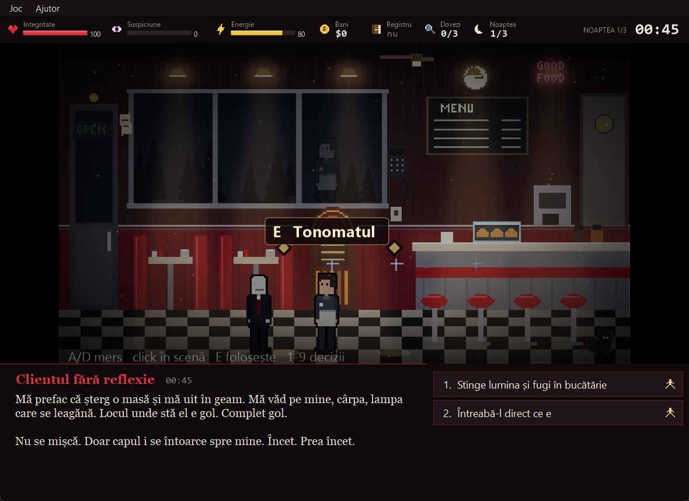 | 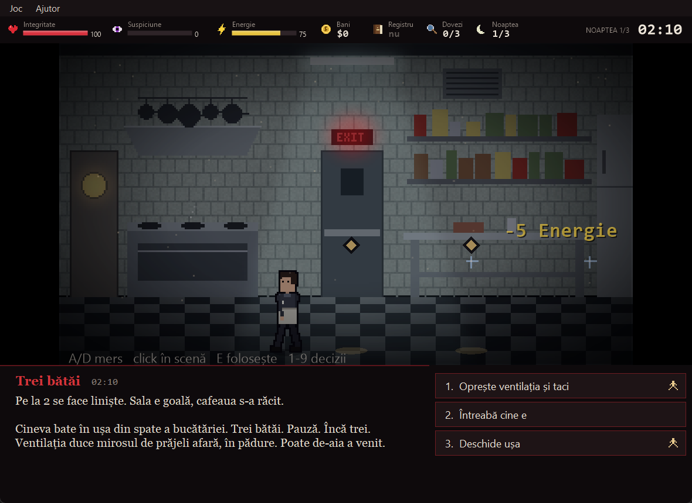 |
| **Km 13: fetița nu apare în geam** | **Km 13: farurile** |
| 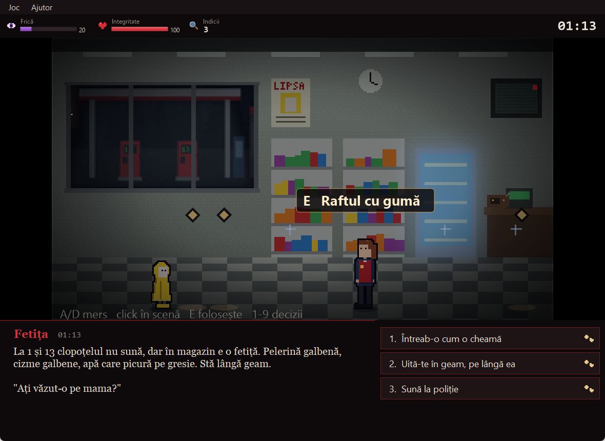 | 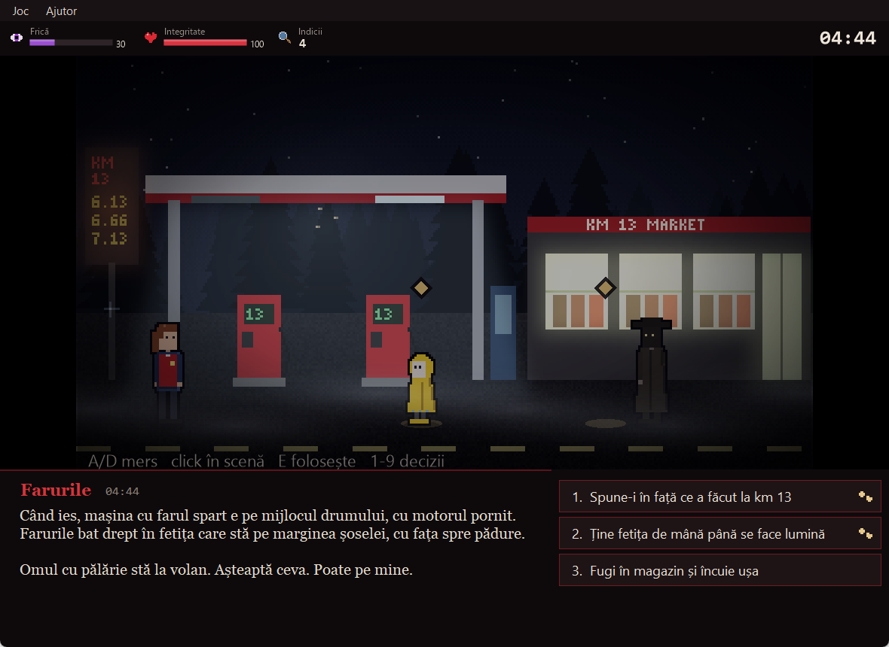 |
| **1987: obiecte de examinat** | **1987: final secret** |
| 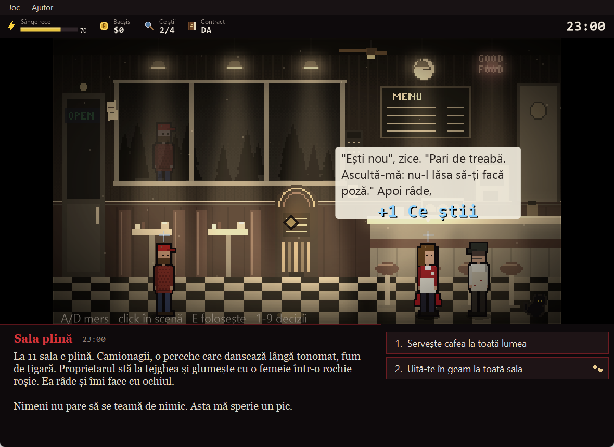 | 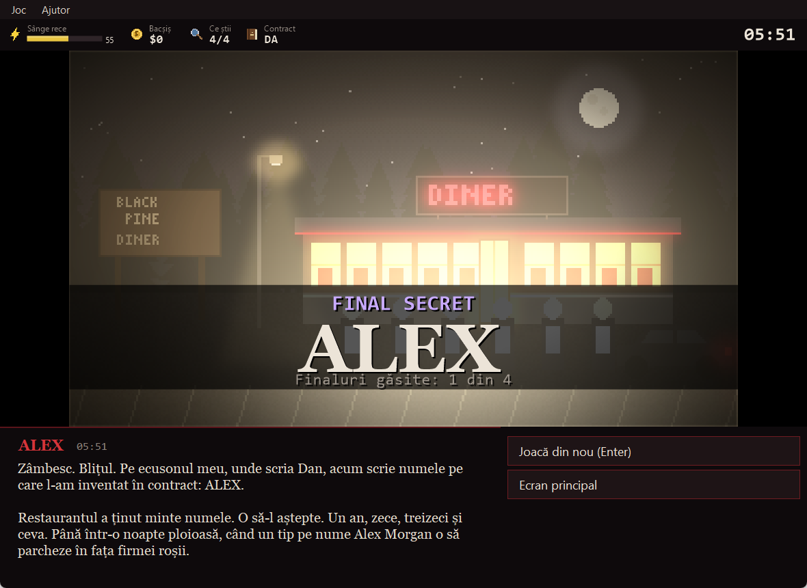 |

### 4.2 Asseturi (originale, generate de pachetul `tools/art/`)

| Tip | Ce conține |
|---|---|
| Locații (320×180) | Restaurantul: parcarea, parcarea dimineața, sala (cu tonomat, vitrină cu plăcinte, cafetiere), bucătăria, biroul și biroul din 1987 (fără poze). Benzinăria: pompele, magazinul (cu telefon de perete), magazia. |
| Finaluri (320×180) | 13 imagini: răsărit, angajatul lunii, pisica în mașină, harta, radioul, farurile, blițul, noul proprietar etc. |
| Prim-planuri (160×120) | Registrul, fotografia din 1987, înregistrarea, ziarul din 1998, contractul. |
| Personaje (6 cadre, contur colorat, brațe și genunchi animați) | Alex, dublura, clientul fără față, femeia în roșu, camionagiul, Mara, Dan, proprietarul, omul cu pălărie, fetița, ospătarii din 1987, perechea de la tonomat. |
| Obiecte de bloc | Mașina omului cu pălărie (parcată / cu el la volan), conul farului, biletul cu cheia, aparatul foto cu bliț. |
| Decor animat | Ventilator de tavan, firmă OPEN care pâlpâie, abur de cafea, pisică neagră, molii, tub de neon, radio, LED-ul camerei. |
| Iconițe | 7 pentru HUD; 3 pentru butoane (mers, lacăt, ochi), desenate în cod. |

### 4.3 Core (`LastStopNight.Core`)
- **Model complet din document**, plus `LocationDefinition` (podea, limite, ferestre, puncte, decor, lumini, obiecte), `CharacterDefinition` și `ExamineDefinition`.
- **`GameEngine`:**
  - `Start`, `GetDecisions`, `Choose`;
  - `GetExamines` și `Examine` (efectele se aplică o singură dată, apoi se verifică redirecționările).
- **`ConditionParser` / `EffectParser`** pentru editare ca text, cu mesaje de eroare în română.
- **`StoryArchive`:** încarcă `.zip` sau `story.json` și salvează în ambele formate; salvarea ZIP e atomică.
- **`StoryValidator`:** destinații, chei, imagini, fundături, blocuri inaccesibile, obiecte fără ID etc.

### 4.4 Player 2D (`LastStopNight`)
- **Meniu principal** cu toate poveștile din `Assets/stories`, sortate după `order`. Arată și câte finaluri ai găsit din fiecare.
- **Scena:**
  - decor animat, lumini care pâlpâie, praf, ceață;
  - reflexii în geamuri;
  - licăriri calde (decizii) și reci (obiecte de examinat), puse chiar pe obiect;
  - când ești aproape: colțuri luminoase în jurul obiectului și o tastă E mică, urmată de numele acțiunii.
- **Bulă de dialog** cu ce observă personajul (efect de mașină de scris).
- **Personajul vorbește singur** dacă stai degeaba prea mult.
- **Butoanele de decizie** sunt desenate manual: textul se rupe pe mai multe rânduri, au iconiță pentru „mergi acolo” și lacăt pentru deciziile blocate, iar motivul apare în text.
- **Text cu efect de mașină de scris,** cu pauză scurtă după punct.
- **Carduri de capitol, ecrane de final** și finaluri descoperite, salvate în `%AppData%\LastStopNight\endings.txt`.

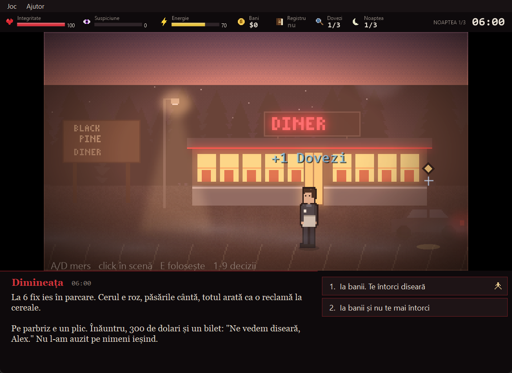

### 4.5 Editor (`LastStopNight.Editor`)

| Bloc: tab-urile Decizii și Obiecte de examinat | Locații: podea, limite, ferestre, obiecte |
|---|---|
| 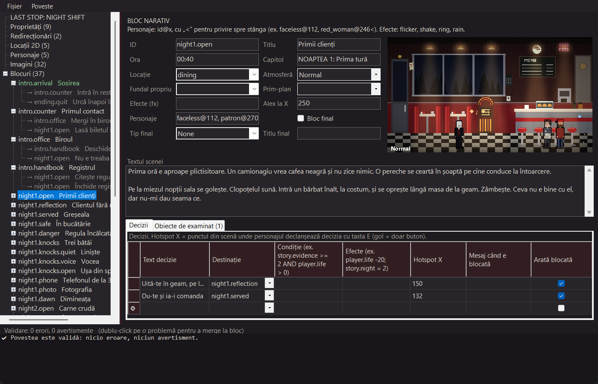 | 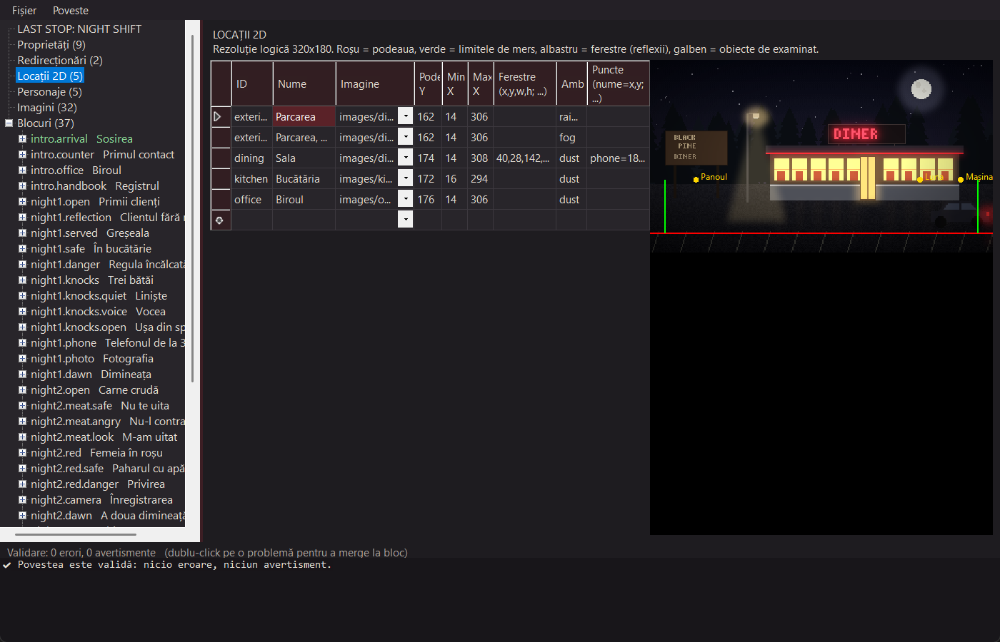 |

- **TreeView** cu povestea, proprietăți, redirecționări, locații, personaje, imagini și blocuri, cu deciziile sub fiecare bloc.
- **Pagina de bloc:**
  - toate câmpurile, inclusiv atmosferele noi `Dawn` și `Sepia`;
  - tabel de decizii;
  - tabel de **obiecte de examinat** (text, efecte, condiție, „o dată”, „ascuns”);
  - previzualizare 2D live.
- **Locațiile** păstrează decorul, luminile și obiectele. Previzualizarea arată podeaua, limitele, ferestrele și obiectele.
- **Comenzi:** validare (F6), salvare ZIP sau folder, Testează în Player (F5), adăugare / duplicare / ștergere de blocuri. Redenumirea unui bloc își actualizează automat referințele.

---

## 5. Versiunea 2: ce s-a schimbat

| Problemă raportată | Ce am făcut |
|---|---|
| **Simboluri ciudate în alegeri** (◆, [blocat], ghilimelele „”) | Butoanele au acum doar text și o iconiță desenată (omuleț pentru mers, lacăt pentru blocat), iar motivul blocării apare simplu în paranteză. Textele folosesc ghilimele obișnuite. |
| **Liniuța lungă (—)** | Am scos-o din toate textele și din interfață. `StoryCheck` verifică automat că nu reapare. |
| **Prea scurt** | Night Shift a crescut de la 21 la 37 de blocuri și de la 5 la 7 finaluri. Am adăugat încă 2 povești (în total 70 de blocuri și 15 finaluri), plus zeci de obiecte de examinat. |
| **Să pară făcut de om** | Textul e rescris la persoana I, cu fraze scurte, umor și detalii mărunte („Bucătarul nu există, deci bucătarul sunt eu”). Personajul comentează ce vede și vorbește singur când stai degeaba. |
| **Easter egg-uri** | 10+ easter egg-uri: obiecte ascunse, un final secret cu pisica, codul Konami (mod VHS) și legături între cele 3 povești. Lista e în secțiunea 11. |
| **Pare lag-uit** | Lumea se desenează direct cu transformare (fără bitmap intermediar), cu poziții fracționare, deci mersul e fluid, nu sacadat pixel cu pixel. Fonturile și pensulele sunt create o singură dată, HUD-ul se redesenează doar când se schimbă starea, timer-ul de sistem e setat la 1 ms (`timeBeginPeriod`), iar mersul are accelerare. Rezultatul măsurat: **~7-8 ms pe cadru**. |
| **Grafică mai bună** | Decor animat, lumini care pâlpâie, praf, ceață moale, zori, sepia pentru 1987. Personajele au umbre și lumini pe păr, iar sala are tonomat, vitrină cu plăcinte, cafetiere și afișe. Am adăugat 3 locații noi și 5 personaje noi. |

### Versiunea 3: review și reparații

Review-ul complet, bloc cu bloc, e în [docs/REVIEW.md](docs/REVIEW.md). Pe scurt:

| Problemă raportată | Ce am făcut |
|---|---|
| **KM 13: mașina nu există,** deși personajul se duce la ea | Am adăugat mașina, oprită la pompa 2 și apoi pe mijlocul drumului, cu el la volan și farul bătând în fetiță. La aceeași verificare am mai găsit 9 nepotriviri text-scenă: ospătarii și perechea din 1987, biroul care avea deja poze, telefonul din magazin, biletul de pe tejghea și altele. Le-am rezolvat pe toate. |
| **Butoanele de interacțiune apar peste,** ar trebui doar să sugereze | Marcajele stau acum pe obiect, la înălțimea lui (`y` / `hotspotY`), și licăresc discret. Indiciul e o tastă E mică lângă obiect, fără cutie, și nu mai apare peste prim-plan. Prim-planul e mai mic, iar rândul cu taste dispare după 20 de secunde. |
| **Grafica** | Personajele sunt redesenate de la zero, iar locațiile colorează personajele (`actorTint`). Monitorul CRT e nou și am adăugat 7 personaje sau variante noi și 6 obiecte noi. |

| Mașina la pompă | Ospătarii din 1987 |
|---|---|
| 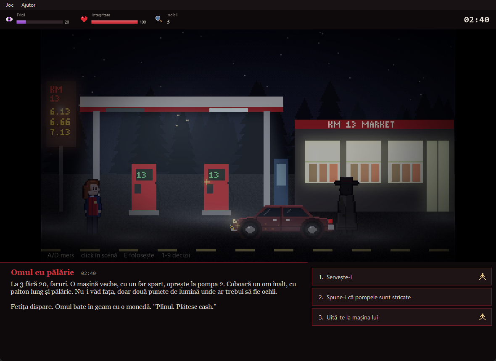 | 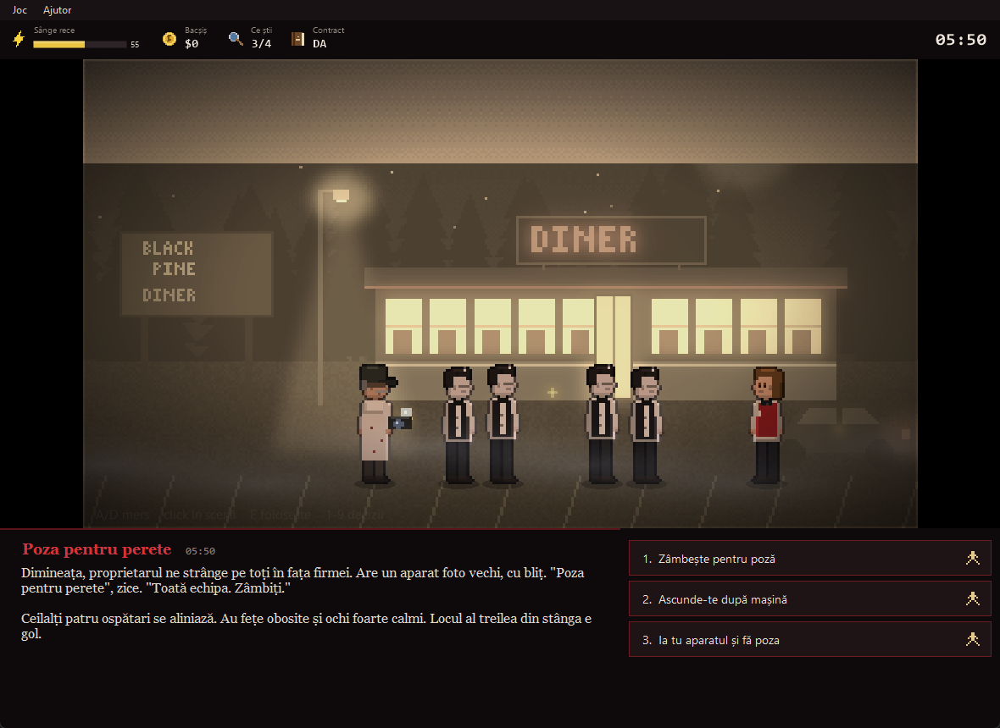 |

### Versiunea 4: meniuri, HUD, însoțitori

Planul complet (inclusiv multiplayer-ul P2P, încă neînceput) și ce s-a făcut din el sunt în [docs/PLAN_V4_MULTIPLAYER.md](docs/PLAN_V4_MULTIPLAYER.md).
- **Meniuri desenate în joc:**
  - meniul principal, cu Continuă;
  - cartonașele poveștilor;
  - alegerea însoțitorului;
  - Setări;
  - Finaluri găsite;
  - pauză pe Esc.
- **HUD nou:** portretele echipei, bare segmentate care clipesc la schimbări și un ceas digital.
- **Însoțitori:** Ioana (Night Shift), Vlad (KM 13) și Lucia (1987) au replici, decizii și scene proprii. Ioana are și un final doar al ei.
- **Salvare automată** la fiecare acțiune. „Continuă” reaplică acțiunile salvate, pentru că motorul e determinist.

| Pauză | 1987 cu Lucia |
|---|---|
| 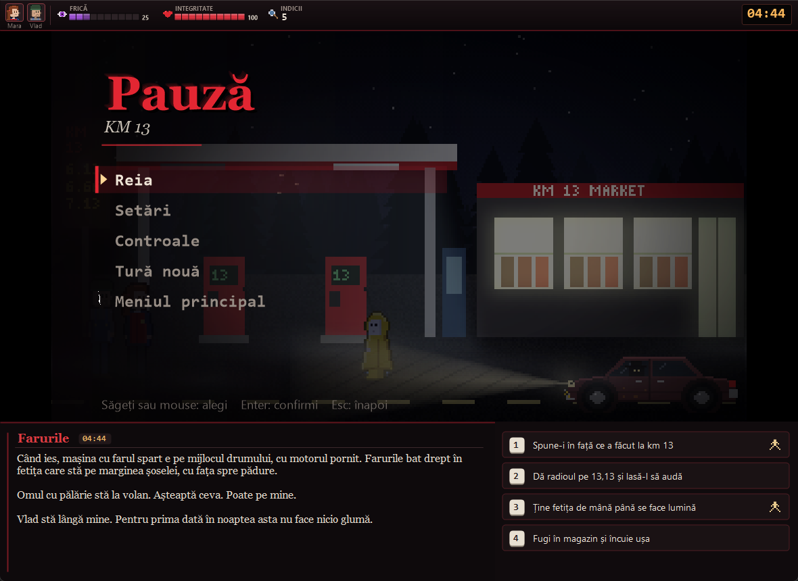 | 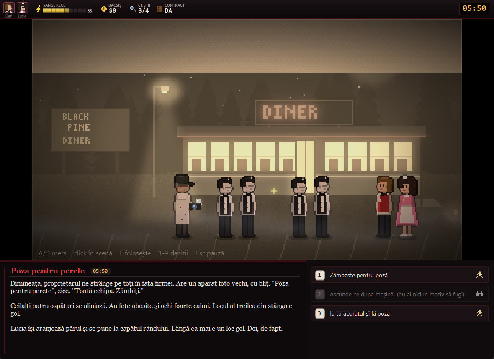 |

### Multiplayer și exe de trimis

Doi jucători, fiecare cu personajul lui, joacă P2P: unul găzduiește, celălalt intră cu un cod. Ghidul e în [docs/MULTIPLAYER.md](docs/MULTIPLAYER.md), iar detaliile tehnice în [docs/PLAN_V4_MULTIPLAYER.md](docs/PLAN_V4_MULTIPLAYER.md#10-ce-s-a-implementat-etapele-5-8). Exe-ul de trimis se face cu `build_release.ps1`, iar rezultatul e `dist\LastStopNight.exe`.

### Sunet

Jocul nu mai e mut. Toate sunetele sunt generate procedural (`tools/sound/`, doar Python standard), deci nu există fișiere descărcate sau licențe.

- **Ambianța locației** vine din story.json (`"sounds"` pe locație): ploaie și vânt în parcare, neon și frigider în sală, ceasul din birou, greieri la benzinărie, păsări în zori. În scenele întunecate sau roșii se adaugă o dronă de tensiune. Între locații, ambianța trece lin.
- **Efecte:** pași (și ai însoțitorului / celuilalt jucător, mai încet), telefonul care sună, neonul care pâlpâie, tremurul, lovitura, cardul de capitol, decizii, decizii blocate, examinări, prim-planuri, modul VHS.
- **Meniuri:** muzică proprie, sunete la navigare, confirmare și înapoi; în multiplayer, vot și intrarea / ieșirea unui jucător.
- **Finaluri:** o temă scurtă după tipul finalului (bun, rău, secret, alternativ).
- **Setări:** volum separat pentru narator, efecte, ambianță și muzică (tasta M nu mai există).

### Naratorul, replicile și hârtiile

- **Naratorul citește fiecare scenă**, ca să nu trebuiască să citești tot textul. Vocea e neurală, în română: Emil când protagonistul e bărbat (Night Shift, Black Pine), Alina pentru Mara (KM 13). Citește și paragrafele însoțitorului, iar cât vorbește, ambianța și muzica se aud mai încet.
- Vocile sunt generate o singură dată de `tools/build_voice.py` (edge-tts, apoi ffmpeg în WAV IMA ADPCM, ~11 KB/s) și stau în arhiva poveștii, în `voice/<bloc>.wav` și `voice/<bloc>@<însoțitor>.wav`. Cele trei povești au ~29 de minute de voce (~19 MB). Jocul le citește fără internet.
- **Replicile apar în bule** deasupra celui care vorbește, cam când le rostește naratorul. Cine vorbește se deduce din text: „...”, zic → protagonistul; „...”, zice Ioana → Ioana. Ghilimelele fără verb de vorbire (un bilet, radioul) rămân doar în text.
- **Hârtiile** (regulile din registru, biletul de pe tejghea) apar mari peste scenă, scrise de mână, nu în caseta de jos. În story.json: `"paper": { "title": "...", "text": "...", "note": false }` pe bloc. Tasta C le ascunde sau le arată, ca prim-planurile.

## 6. Cum rulezi

Ai nevoie de **.NET SDK 10** (Windows). Pentru a regenera asseturile ai nevoie și de Python 3 cu Pillow (opțional, arhivele sunt deja generate).

Deschide `LastStopNight.slnx` în Visual Studio și pornește proiectul `LastStopNight` (Player) sau `LastStopNight.Editor`. Din linia de comandă:

```powershell
dotnet run --project LastStopNight
```

```powershell
dotnet run --project LastStopNight.Editor
```

Verificarea automată a tuturor poveștilor:

```powershell
dotnet run --project tools/StoryCheck
```

Regenerarea imaginilor, a story.json-urilor și a arhivelor:

```powershell
python tools/build_story.py
```

> ⚠️ `build_story.py` **suprascrie** `stories/<id>/story.json`. Dacă ai editat o poveste în Editor, nu rula scriptul.
> Pentru ca Player-ul să folosească varianta editată, salvează din Editor în `LastStopNight/Assets/stories/<id>.zip`
> sau deschide arhiva din Player (Ctrl+O).

Moduri de dezvoltare:
- `LastStopNight.exe --snapshots <dir> <poveste[:însoțitor]> <decizii> [secunde]` capturează meniurile, apoi joacă automat și face capturi (ex. `1:vlad`). Numerele negative înseamnă „examinează obiectul n”, iar `continue` în loc de poveste reia salvarea. La final scrie timpul mediu de desenare în `perf.txt`. Cu variabila `LASTSTOP_DATA` setată, salvările testului merg în alt dosar.
- `LastStopNight.Editor.exe --selftest <dir>` vizitează toate paginile și verifică că nu se pierde nimic.

## 7. Cum se joacă

| Tastă | Acțiune |
|---|---|
| A / D sau ← / → | mergi |
| Click în scenă | mergi până acolo; click pe un obiect marcat îl folosește |
| E | folosești ce e lângă tine: o decizie (licărire caldă) sau un obiect (sclipire rece); închide și prim-planul |
| 1 - 9 sau click pe buton | alegi o decizie |
| Space | tot textul deodată |
| C | ascunzi / arăți imaginea mare |
| Esc | te oprești din mers; dacă stai pe loc, deschide pauza |
| H | harta turei: pe unde ați trecut, unde e fiecare și cum îi merge |
| F | multiplayer: mergi după cine a ales și a plecat |
| F1 / F11 | controale / ecran complet |
| Săgeți, Enter, Esc, mouse | navighezi prin meniuri |

## 8. Formatul poveștii (story.json)

```jsonc
{
  "title": "LAST STOP: NIGHT SHIFT", "order": 1,
  "startBlockId": "intro.arrival", "playerCharacterId": "alex",
  "properties": [
    { "key": "player.life", "min": 0, "max": 100, "initial": 100, "hudLabel": "Integritate",
      "display": "bar", "icon": "images/ui/heart.png", "color": "#D8333F" },
    { "key": "story.cat", "min": 0, "max": 3, "initial": 0, "hudLabel": "Pisica", "display": "hidden" },
    { "key": "story.evidence", "min": 0, "max": 3, "initial": 0, "hudLabel": "Dovezi", "format": "{0}/3",
      "shared": true }   // multiplayer, drumuri separate: ce găsește un drum se adună și la ceilalți
  ],
  "redirects": [
    { "condition": { "type": "COMPARISON", "key": "player.life", "operator": "<=", "value": 0 },
      "target": "ending.captured", "description": "Nu mai ai putere să te ridici" }
  ],
  "locations": [
    { "id": "dining", "image": "images/diner_interior.png", "floorY": 174, "minX": 14, "maxX": 308,
      "windows": [{ "x": 40, "y": 28, "w": 142, "h": 62 }], "ambient": ["dust"],
      "sounds": ["room", "hum"],   // ambianța în buclă: rain, wind, night, hum, room, clock, birds, tension
      "decor":  [{ "image": "images/decor/cat.png", "x": 296, "y": 161, "frameWidth": 16, "frameHeight": 14, "fps": 2 }],
      "lights": [{ "x": 276, "y": 18, "radius": 18, "color": "#FF5080", "alpha": 60, "flicker": 0.5 }],
      "actorTint": "#F2E6DA",
      "examine": [{ "id": "din.jukebox", "x": 153, "y": 116, "label": "Tonomatul", "text": "Are un singur disc...", "effects": [] }] }
  ],
  "blocks": [
    { "id": "night3.double", "title": "Dublura", "text": "...", "location": "dining", "time": "05:30", "mood": "dim",
      "characters": [{ "id": "double", "x": 60 }],
      "examine": [],
      "props":  [],   // obiecte doar pentru acest bloc, ex. { "image": "images/props/car.png", "x": 146, "y": 132, "frameWidth": 80, "frameHeight": 30 }
      "lights": [],   // lumini doar pentru acest bloc (ex. farurile)
      "decisions": [
        { "text": "Arată-i dovezile", "target": "ending.sunrise",
          "condition": { "type": "AND", "children": [
            { "type": "COMPARISON", "key": "player.life", "operator": ">", "value": 0 },
            { "type": "COMPARISON", "key": "story.evidence", "operator": ">=", "value": 2 } ] },
          "effects": [{ "key": "inventory.money", "op": "add", "value": 300 }],
          "lockedHint": "ai nevoie de cel puțin 2 dovezi" },
        { "text": "Ia pisica în brațe și ieși prin spate", "target": "ending.cat",
          "condition": { "type": "COMPARISON", "key": "story.cat", "operator": ">=", "value": 3 },
          "showWhenLocked": false, "hotspotX": 292, "hotspotY": 166, "effects": [] }
      ] }
  ]
}
```

## 9. Testare și verificare

| Verificare | Rezultat |
|---|---|
| Build pentru toată soluția (Core, Player, Editor, StoryCheck) | ✅ 0 erori, 0 avertismente |
| `StoryCheck`: explorarea tuturor stărilor accesibile (decizii + obiecte examinate), cu stările identice comasate | ✅ Night Shift: 210.843 stări, 1987: 238 stări, Km 13: 4.347 stări |
| Toate finalurile accesibile, toate blocurile atinse, nicio fundătură | ✅ la toate cele 3 povești (15 finaluri) |
| Validare | ✅ 0 erori. Un avertisment intenționat în 1987: alegerea finală are doar decizii condiționate, dar două dintre ele sunt complementare, deci mereu e una disponibilă |
| Fără liniuțe lungi sau simboluri ciudate în texte | ✅ verificat automat |
| JSON round-trip, parsere, redirecționare automată | ✅ |
| Player: rulare automată completă (Night Shift până la final, Km 13 până la alegerea finală, 1987 până la finalul secret) | ✅ ~7-8 ms pe cadru, adică loc pentru peste 100 de cadre pe secundă |
| V3: capturi din fiecare poveste după reparații (mașina, ospătarii, perechea, monitorul, indiciul E) | ✅ în `docs/screenshots/11-16` |
| Editor: vizitarea celor 102 noduri | ✅ povestea rămâne neschimbată, 0 probleme |

Netestat: jocul manual de la tastatură în sesiune interactivă (mersul A/D și tasta E au fost verificate prin mersul automat la puncte și prin cod), codul Konami și butonul „Testează în Player” din Editor.

## 10. Abateri de la document și limitări

- **Imaginile sunt PNG,** nu JPG: pixel-art-ul nu suportă compresia cu pierderi. Personajele sunt spritesheet-uri.
- **Câmpuri adăugate pentru 2D** (locații, decor, lumini, obiecte, puncte în scenă, atmosferă, capitole): toate sunt opționale, deci o poveste simplă, doar cu blocuri, funcționează în continuare.
- **Fără sunet:** WinForms nu are mixaj audio fără biblioteci externe. Telefonul și pericolul sunt semnalate vizual.
- **Fără salvare a progresului** în timpul unei povești; se rețin doar finalurile găsite.
- **Probleme cunoscute,** precum personajele care se uită mereu spre jucător sau Dacia din 1987 care nu se vede: lista e în [docs/REVIEW.md](docs/REVIEW.md#4-ce-mai-rămâne-cunoscut-nerezolvat).

## 11. Easter egg-uri (spoilere)

<details>
<summary>Deschide doar după ce ai terminat poveștile</summary>

- **Pisica neagră** de sub tejghea: dacă o mângâi (E) în toate cele trei nopți, la dublură apare o decizie ascunsă și finalul secret **Pisica de noapte**.
- **Codul Konami** (↑ ↑ ↓ ↓ ← → ← → B A) pornește sau oprește modul VHS (linii de scanare și „PLAY”).
- **Obiecte ascunse** (fără marcaj; le găsești doar dacă treci pe lângă ele și apeși E):
  - luna din parcare;
  - afișul ANGAJĂM de lângă ușă;
  - tigaia nespălată;
  - calculatorul cu parola ALEX;
  - silueta de la fereastra biroului;
  - cabina telefonică cu fise;
  - raftul cu gumă;
  - mopul cu numele Marei.
- **Legături între povești:**
  - În Night Shift, radioul din mașină (a doua dimineață) anunță un accident la **km 13**.
  - În 1987, Dan poate rupe **ultima pagină** din registru (pagina care lipsește în Night Shift).
  - Dacă Dan semnează contractul cu **alt nume**, finalul secret arată cum „Alex” din fotografia din 1987 a ajuns acolo.
  - Ecusoanele vechi: „ALEX, 1961”.
- **Dosarele din birou** sunt toate pe numele unui Alex.
- **Tonomatul** are un singur disc: *Tura de noapte (încă o dată)*.

</details>
