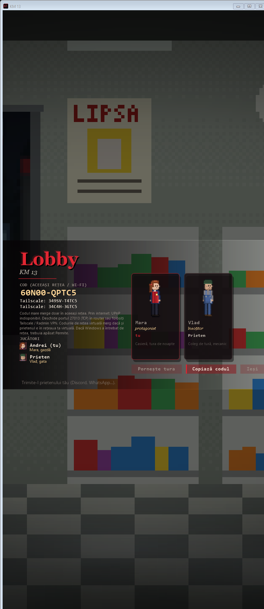
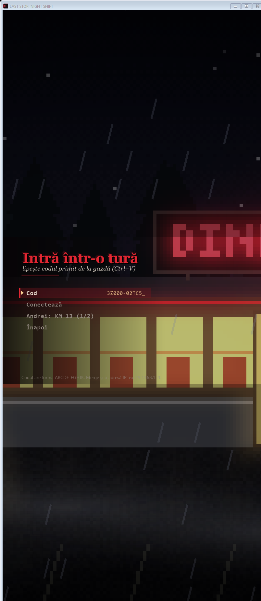
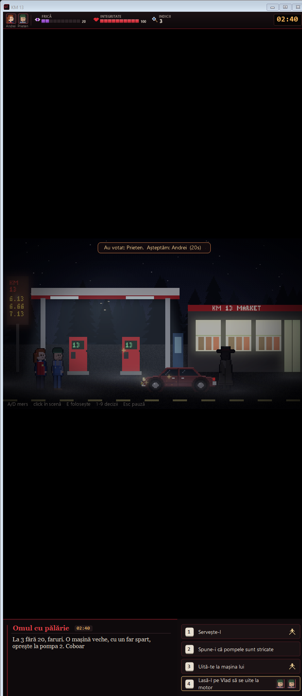

# Cum joci Last Stop în doi

**Pe scurt:** unul dintre voi găzduiește tura, iar celălalt intră cu un cod. Nu există server și nici cont, iar jocul e un singur fișier: `LastStopNight.exe`.

## 1. Fișierul

- Cine are proiectul rulează:
  ```powershell
  powershell -ExecutionPolicy Bypass -File build_release.ps1
  ```
- Rezultatul e `dist\LastStopNight.exe`, de aproximativ 51 MB. Include .NET și cele 3 povești, deci nu trebuie instalat nimic.
- Trimite-l prietenului: Discord, WhatsApp, Google Drive. Funcționează și ca zip, `dist\LastStopNight.zip`.
- La prima pornire, Windows poate spune „Windows a protejat PC-ul”. Apasă **Mai multe informații**, apoi **Rulează oricum**. Avertismentul apare pentru că exe-ul nu e semnat digital.
- **Amândoi trebuie să aveți același exe.** Dacă versiunile diferă, jocul vă spune asta la conectare.

## 2. Gazda

1. Deschide **Multiplayer**, apoi **Găzduiește o tură** și alege povestea. Fiecare poveste e pentru 2 jucători: protagonistul și însoțitorul.
2. Windows poate întreba dacă jocul are voie în rețea. Bifează **și rețelele private, și cele publice**, apoi apasă **Permite**. Altfel prietenul nu se poate conecta.
3. În lobby primești un **cod de intrare**, de forma `4K7QM-2XD9A`. Apasă **Copiază codul** și trimite-l.
   - Deasupra codului mare scrie unde merge. „PRIN INTERNET” înseamnă că routerul a deschis singur portul; „ACEEAȘI REȚEA / WI-FI” înseamnă că merge doar acasă.
   - Dacă ai Tailscale sau Radmin VPN, sub codul mare apar și codurile pentru ele. Acelea merg dacă prietenul e în aceeași rețea virtuală cu tine, oriunde ar fi.
4. Când prietenul a intrat și a apăsat **Sunt gata**, apasă **Pornește tura**.

| Lobby (gazda) | Intrare cu cod (prietenul) |
|---|---|
|  |  |

## 3. Prietenul

1. Deschide **Multiplayer**, apoi **Intră cu un cod**. Lipește codul cu **Ctrl+V** și apasă Enter.
   - Dacă sunteți pe același Wi-Fi, jocul gazdei apare singur în listă și nu mai ai nevoie de cod.
2. Dacă nu ai povestea, gazda ți-o trimite automat.
3. Alege-ți personajul. Unul e **protagonistul**, care spune povestea, iar celălalt e **însoțitorul**, cu replicile și deciziile lui. Apoi apasă **Sunt gata**.

## 4. În joc

- **Fiecare se mișcă liber** și îl vede pe celălalt în scenă. Fiecare poate examina obiecte, iar ce găsește unul (indicii, frică) contează pentru amândoi.
- **Deciziile se votează.** Pe butoane apare portretul celui care a votat, iar sus scrie pe cine se mai așteaptă.
  - Dacă votați la fel, mergeți împreună mai departe.
  - **Dacă votați diferit, vă despărțiți** (cu „Drumuri separate: Da”, opțiunea implicită): fiecare merge pe drumul ales și joacă de acolo singur, până la finalul lui. Așa explorați două rute deodată.
  - Cu „Drumuri separate: Nu”, rămâneți mereu împreună: câștigă majoritatea, iar la egalitate cine a votat primul.
  - Dacă cineva nu votează, după 20 de secunde se ia votul existent (fără despărțire).
- **Drumuri separate:**
  - opțiunea e în lobby, sub jucători, și o alege gazda;
  - după despărțire, celălalt nu mai e în scena ta, iar în dreapta sus scrie unde a ajuns pe drumul lui;
  - pe drumul tău decizi singur, fără să aștepți votul celuilalt;
  - echipa rămâne doar cu personajul tău: replicile și deciziile celuilalt dispar;
  - textul poveștii rămâne scris de protagonist, chiar și pe drumul însoțitorului;
  - nu vă mai puteți reuni în aceeași tură: fiecare ajunge la finalul lui, apoi gazda vă duce înapoi în lobby.
- **Harta (tasta H** sau „Hartă” din pauză):
  - arată blocurile prin care ați trecut, ca un arbore care se ramifică unde v-ați despărțit;
  - fiecare drum are culoarea lui, iar portretele arată unde e fiecare acum;
  - lângă fiecare bloc, „+2” înseamnă câte alegeri n-a încercat încă nimeni;
  - în dreapta, câte un cartonaș pe drum: cine e acolo, locul, ora, barele (frică, integritate...) și indiciile.
- **Esc** deschide meniul, dar jocul nu se oprește pentru celălalt.
- **La final,** gazda vă duce înapoi în lobby, unde puteți schimba personajele și juca din nou.



## 5. Dacă nu vă puteți conecta

| Situație | Ce faci |
|---|---|
| Sunteți pe **același Wi-Fi / rețea** | Merge direct: jocul apare în listă, sau folosiți codul din lobby. |
| **Internet**, iar routerul gazdei permite UPnP | Jocul deschide singur portul. În lobby scrie „Merge prin internet” și apare codul pentru internet. |
| **Internet**, fără UPnP | Gazda deschide manual în router portul **27013 (TCP)** spre calculatorul ei. |
| **Internet mobil, cămin, CGNAT** (lobby-ul spune „IP privat”) | Instalați amândoi **Tailscale** sau **Radmin VPN** (gratuite), intrați în aceeași rețea virtuală și folosiți codul de „rețea locală”. |
| „Gazda nu răspunde” | Verificați codul, că gazda a apăsat **Permite** la firewall și că jocul gazdei e încă în lobby. Dacă ați apăsat greșit la firewall: Windows Security, apoi Firewall și protecția rețelei, apoi Permite o aplicație prin firewall, și bifați Last Stop. |
| „Celălalt jucător nu mai răspunde” | Internetul unuia a căzut sau jocul s-a închis. Jocul observă asta în cel mult 20 de secunde. Gazda găzduiește din nou, iar prietenul intră cu același cod. |
| „Tura a început deja” | Intră după ce gazda vă duce înapoi în lobby. |

## 6. Cum funcționează (pentru curioși)

- **Fiecare calculator rulează povestea singur.** Gazda doar stabilește ordinea acțiunilor (voturi, examinări) și le trimite tuturor, numerotate. Motorul dă mereu același rezultat pentru aceleași acțiuni, deci ajungeți în aceeași stare.
- **După fiecare acțiune, clientul trimite o amprentă a stării.** Dacă nu se potrivește cu a gazdei, gazda îi retrimite tot jurnalul și starea se repară singură.
- **Drumurile separate** sunt motoare separate, câte unul pe drum. Fiecare calculator le ține pe toate (nu doar pe al lui), așa că gazda poate verifica amprenta oricărui drum, iar tu vezi unde e celălalt. La despărțire, drumul nou pornește ca o copie exactă a celui vechi.
- **Pozițiile personajelor** se trimit separat, de ~15 ori pe secundă. Sunt doar vizuale și nu schimbă povestea.
- **Semnal de viață:** fiecare parte trimite la 2 secunde un semnal. După 20 de secunde de liniște, conexiunea e considerată pierdută, cu mesaj clar, în loc să aștepte la nesfârșit.
- **Rețeaua:**
  - jocul folosește TCP pe portul 27013 (sau următorul liber);
  - jocurile din rețeaua locală se anunță pe UDP, portul 27014;
  - codul de intrare conține IP-ul și portul gazdei, scrise cu litere și cifre ușor de dictat.
