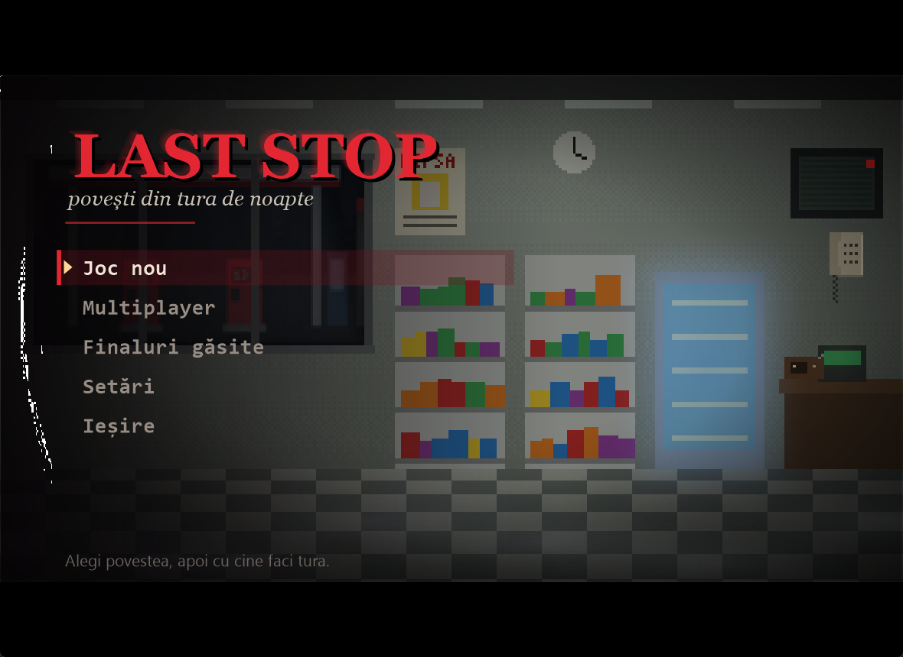
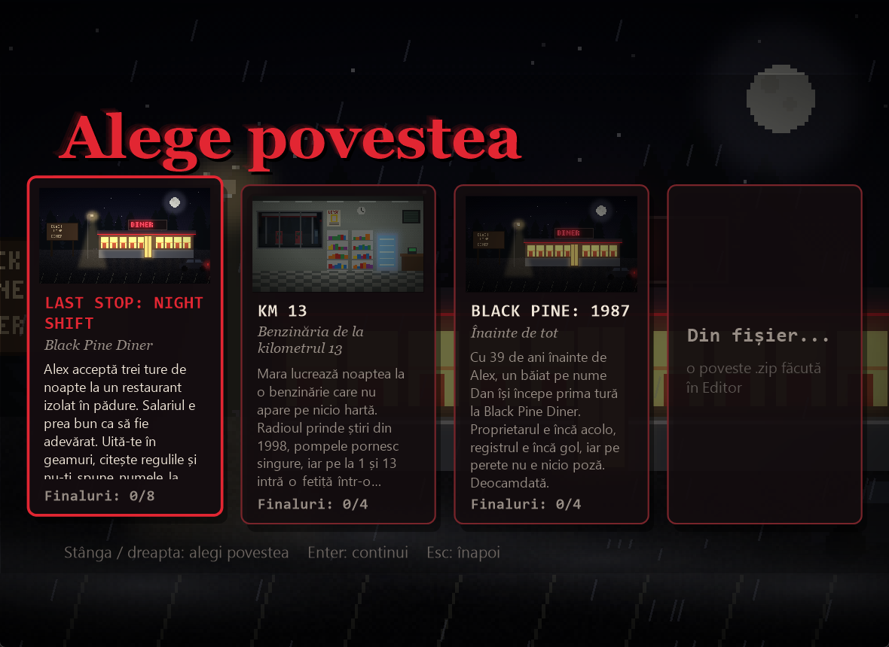
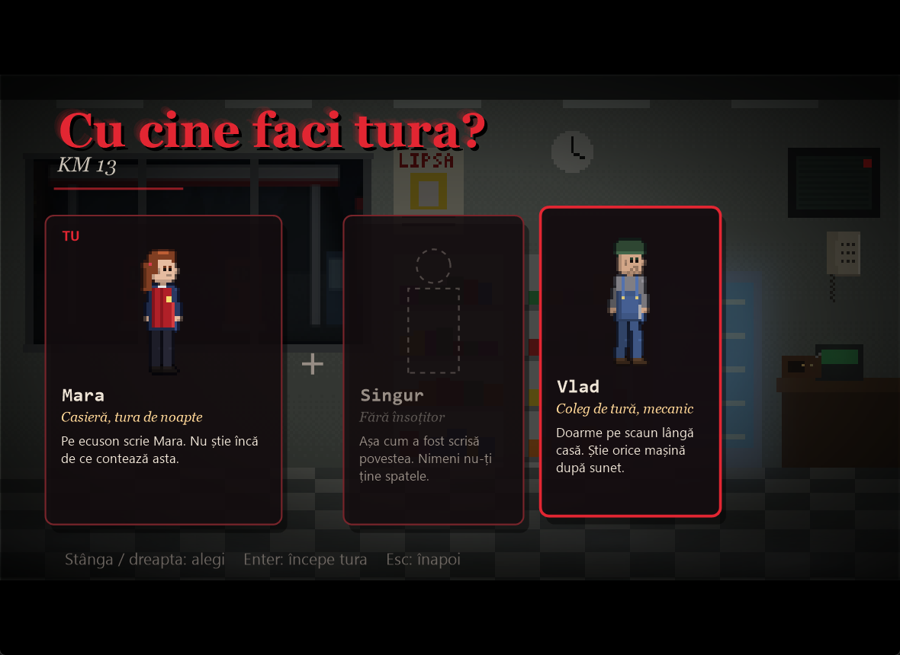
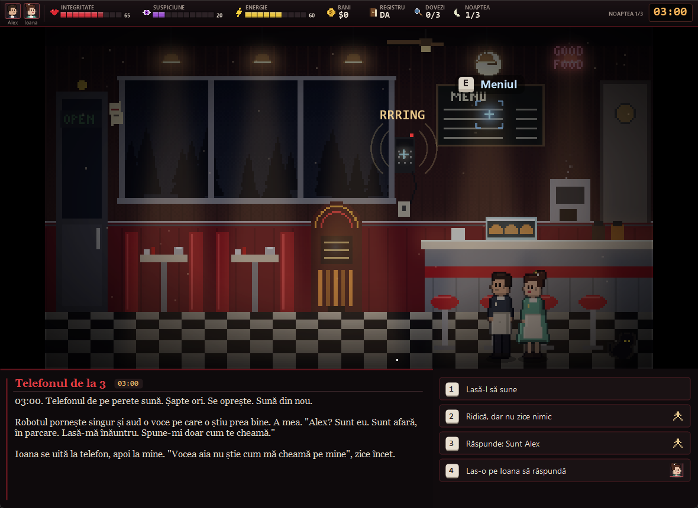
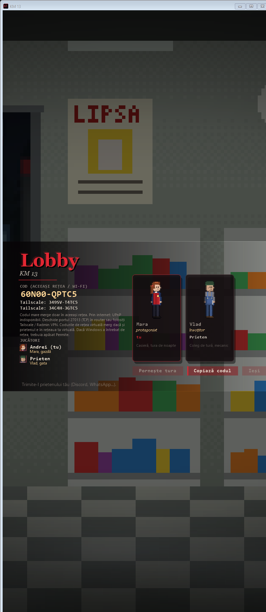
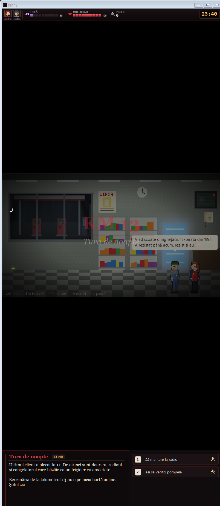

# Plan V4: meniu și HUD noi, single player + multiplayer P2P, exe de distribuit

Stare:
- **Etapele 1-4 sunt făcute:** fundația (acțiuni, jurnal, amprentă), ecranele noi, HUD-ul nou, personajele jucabile și Editorul. Detaliile sunt în secțiunea „Ce s-a implementat” de la final.
- **Etapele 5-8 sunt făcute:** rețeaua P2P, multiplayer-ul în joc, internetul (UPnP, coduri, LAN) și exe-ul de trimis. Detaliile sunt în secțiunea 10.
- **Ghidul pentru jucători** e în [MULTIPLAYER.md](MULTIPLAYER.md).

---

## 0. Pe scurt

| Cerință | Propunere |
|---|---|
| Meniu și HUD redesenate | Meniul principal desenat direct în scenă (nu butoanele WinForms din dreapta), cu ecrane: Joc nou, Multiplayer, Povești, Setări. HUD-ul devine o bandă compactă, iar în multiplayer apar portretele jucătorilor și voturile lor. |
| Single player | Rămâne jocul de acum, dar intrat prin meniul nou și cu alegere de personaj. |
| Multiplayer, fiecare își alege personajul | 2-4 jucători în aceeași poveste. Fiecare are personajul lui în scenă, se mișcă liber și examinează singur. **Deciziile se votează.** |
| P2P | Cine găzduiește e doar un alt jucător, nu există server separat. Conexiunea e TCP directă între calculatoare. |
| Un .exe de trimis prietenului | `dotnet publish` self-contained, single-file: **un singur `LastStopNight.exe`**, fără instalare .NET, cu poveștile incluse. |

---

## 1. De ce merge bine la jocul ăsta

`GameEngine` e **determinist**: nu folosește `Random` și nici ora sistemului, iar starea depinde doar de povestea încărcată și de șirul de acțiuni (decizii + examinări).

Consecința: **nu trimitem starea jocului prin rețea, ci doar acțiunile** (modelul „lockstep”):
- Fiecare jucător rulează propriul `GameEngine`. Host-ul decide **ordinea** acțiunilor și le trimite tuturor.
- Fiecare aplică aceleași acțiuni în aceeași ordine și ajunge la aceeași stare.
- După fiecare bloc, fiecare trimite un **hash al stării** (`blockId` + valorile proprietăților + obiectele examinate). Dacă un hash nu se potrivește (desincronizare), host-ul retrimite istoricul și clientul îl reaplică.

Doar pozițiile personajelor (unde merge fiecare) se trimit continuu, de ~15 ori pe secundă, și sunt pur vizuale: nu afectează povestea.

---

## 2. Arhitectură

```
LastStopNight.Core/           (neschimbat ca rol, câteva adăugiri)
  Model/StoryDefinition       + PlayableCharacters (lista de personaje alese din meniu), MaxPlayers
  Model/DecisionDefinition    + RequiresCharacter (opțional: „doar Mara poate...”)
  Engine/GameEngine           + StateHash(), istoric de acțiuni (GameAction) reaplicabil
  Engine/GameAction           record: Decision(blockId, index, byPlayer) | Examine(examineId, byPlayer)
  Engine/IGameSession         interfața prin care UI-ul cere acțiuni:
                                LocalSession  -> aplică direct (single player)
                                NetSession    -> trimite cererea la host, aplică ce confirmă host-ul

LastStopNight.Net/            (proiect nou, fără UI)
  Protocol/Messages           mesaje JSON (System.Text.Json), câte unul pe linie, prin TCP
  PeerHost                    ascultă pe un port, ține lobby-ul, ordonează acțiunile, numără voturile
  PeerClient                  se conectează la host, trimite input, primește acțiuni
  Discovery                   anunț UDP pe LAN („joc găzduit de X”) pentru Intră fără IP
  PortMapping                 UPnP (deschide portul automat pe router, dacă routerul permite)
  JoinCode                    cod scurt = IP + port codate (ex. K7Q-2MX-9PA), ușor de trimis pe Discord

LastStopNight/ (Player)
  Screens/                    mașină de ecrane: MainMenu, StoryPicker, CharacterSelect, Lobby,
                              Playing, Ending, Settings (înlocuiește Mode.Title/Playing/Ending)
  Ui/                         componente desenate în scenă: PixelButton, Panel, Portrait, VoteBar
  Rendering/HudRenderer       refăcut (vezi secțiunea 4)
  Game/Scene                  mai mulți PlayerActor: unul local + „RemoteActor” pentru ceilalți
```

**De ce TCP și host-jucător:** e cel mai simplu de făcut corect. Ordinea mesajelor e garantată, iar o poveste cu decizii nu are nevoie de latența unui joc de acțiune. Host-ul e doar arbitru, fiecare joacă pe calculatorul lui, deci rămâne P2P. Nu există niciun server de-al nostru.

---

## 3. Cum se joacă multiplayer

1. **Meniu → Multiplayer.** Apeși **Găzduiește**, alegi povestea și primești un **cod de intrare**. Prietenul apasă **Intră** și lipește codul. Pe aceeași rețea apare singur în listă.
2. **Lobby:**
   - fiecare își alege numele și **personajul** din `PlayableCharacters`; un personaj luat devine gri pentru ceilalți;
   - butonul Gata; host-ul pornește când toți sunt gata;
   - dacă cineva nu are povestea, host-ul i-o trimite automat (zip, verificat cu hash).
3. **În joc:**
   - **Mers și examinat:** fiecare își mișcă liber personajul și examinează ce vrea. Textul obiectului îl vede doar el, dar efectele asupra stării (indicii, frică) sunt comune, fiind ale echipei.
   - **Decizii:**
     - Fiecare votează: tasta 1-9, click pe buton sau E pe obiect.
     - Pe butoane apar portretele celor care au votat. Când votează toți, sau la 20 de secunde după primul vot, câștigă majoritatea. La egalitate decide cine a votat primul.
     - Personajele merg apoi la obiect, ca acum.
   - **Deciziile cu `RequiresCharacter`** („Doar Mara poate deschide casa”) pot fi votate de toți, dar se pot alege doar dacă acel personaj e în echipă.
4. **Deconectare:**
   - **Pleacă un client:** personajul lui dispare, iar jocul continuă.
   - **Pleacă host-ul:** apare „Host-ul a ieșit” și ceilalți se întorc în meniu. Migrarea host-ului ar fi un pas ulterior, opțional.

**Textul poveștii:** rămâne la persoana I, spus de personajul **host-ului** (narator). Ceilalți apar în scenă ca însoțitori. Pentru fiecare poveste adăugăm 1-2 personaje jucabile noi, de exemplu:

| Poveste | Personaje |
|---|---|
| Night Shift | Alex, Sam (bucătarul de noapte), Ioana (ospătăriță) |
| KM 13 | Mara, Vlad (colegul de tură) |
| 1987 | Dan, Lucia (ospătăriță nouă) |

Câteva replici de examinare pot fi diferite în funcție de cine se uită, printr-un câmp nou `TextBy` pe `ExamineDefinition`.

---

## 4. Redesign meniu și HUD

**Meniul principal** (desenat în scenă, cu fundalul poveștii care se mișcă în spate):
- Logo-ul jocului, cu pâlpâit de neon.
- Opțiuni pe verticală, navigabile cu săgeți, Enter sau mouse:
  - Continuă
  - Joc nou
  - Multiplayer
  - Povești
  - Finaluri găsite
  - Setări
  - Ieșire
- **Povești:** carduri cu imagine, titlu, descriere și finalurile găsite (ex. 3/7, cu siluete pentru cele negăsite).
- **Alegerea personajului:** cărți mari cu sprite-ul animat, numele și o frază despre el. Personajul din multiplayer se vede direct în lobby.
- **Setări:**
  - ecran complet;
  - viteza textului;
  - nume de jucător;
  - portul pentru găzduire;
  - mod VHS (easter egg-ul devine opțiune după ce l-ai găsit).

**HUD-ul în joc:**
- **Bandă subțire sus:** iconițe pixel-art cu bare segmentate (nu bare netede), valoarea apare doar când se schimbă, plus ceasul cu cifre de afișaj digital. Proprietățile `flag` devin iconițe care se aprind.
- **Schimbările de stare:** o bară „tremură” și clipește roșu sau verde, în locul textului plutitor +10 de acum. Textul plutitor rămâne doar pentru indicii și bani.
- **Panoul de jos** (text + decizii):
  - textul are un chenar de „jurnal”;
  - deciziile sunt butoane pixel-art;
  - deciziile blocate au lacăt și motiv;
  - în multiplayer, deciziile au portretele votanților și un cronometru subțire.
- **În multiplayer, colțul stânga-sus** arată portretele jucătorilor, cu un punct verde sau roșu pentru conexiune și ping.
- **Meniu de pauză (Esc):** Reia, Setări, Ieși în meniu. În multiplayer, Esc nu oprește jocul pentru ceilalți.

---

## 5. Exe-ul de trimis

```powershell
dotnet publish LastStopNight -c Release -r win-x64 --self-contained true -p:PublishSingleFile=true -p:IncludeNativeLibrariesForSelfExtract=true -o dist
```

- **Rezultatul** e `dist/LastStopNight.exe` (~70-80 MB, include .NET). Prietenul doar îl rulează.
- **Poveștile** (`Assets/stories/*.zip`) intră în exe ca resurse încorporate, deci un singur fișier de trimis. Poveștile puse lângă exe într-un folder `stories/` sunt încărcate în plus.
- **Versiunea protocolului** e verificată la conectare: două exe-uri diferite primesc mesaj clar („actualizează jocul”), nu o desincronizare ciudată.
- **Script `build_release.ps1`:** rulează testele (`StoryCheck`), publică și pune exe-ul într-un zip.
- **Windows SmartScreen** va avertiza la prima rulare, pentru că exe-ul nu e semnat. Prietenul apasă „Mai multe informații → Rulează oricum”. Semnarea costă bani și o lăsăm deoparte.

---

## 6. Conectarea prin internet (partea cea mai riscantă)

| Situație | Merge? |
|---|---|
| Aceeași rețea (LAN, același Wi-Fi) | Da, direct, apare în lista de jocuri. |
| Internet, routerul host-ului acceptă UPnP | Da, portul se deschide automat și codul de intrare conține IP-ul public. |
| Internet, fără UPnP | Host-ul deschide manual portul (implicit **27013**) în router. |
| Internet, CGNAT / rețea de facultate / 4G | **Nu merge direct.** Soluția fără server: amândoi folosesc o rețea virtuală gratuită (Tailscale, ZeroTier sau Radmin VPN) și intră ca pe LAN. |

Varianta „merge oriunde, fără setări” cere un **server de relay sau de rendezvous** (NAT hole punching). Asta înseamnă un server, deci nu mai e P2P pur. Recomand să pornim fără el și să-l adăugăm doar dacă nu reușiți să vă conectați.

---

## 7. Etape

| # | Etapă | Rezultat verificabil |
|---|---|---|
| 1 | **Fundația:** `GameAction`, istoric reaplicabil, `StateHash`, `IGameSession` / `LocalSession`. Single player-ul trece prin ele. | `StoryCheck`: reaplicarea istoricului dă același hash pentru toate stările. Jocul se joacă exact ca acum. |
| 2 | **Ecrane noi:** meniu principal, povești, alegere personaj, setări, pauză. | Single player complet din meniul nou; capturi automate ale fiecărui ecran. |
| 3 | **HUD nou** + panoul de text/decizii refăcut. | Capturi în toate cele 3 povești, același timp pe cadru (~8 ms). |
| 4 | **Date:** `PlayableCharacters`, personaje jucabile noi (sprite-uri în `tools/art/characters.py`), `RequiresCharacter`, `TextBy`; editorul le poate edita. | Validatorul și `StoryCheck` trec; Editorul `--selftest` trece. |
| 5 | **Rețea:** `LastStopNight.Net` (mesaje, host, client), lobby, transferul poveștii. | Test automat: 1 host + 2 clienți în același proces, pe localhost, joacă un drum întreg și au același hash la fiecare bloc. |
| 6 | **Multiplayer în joc:** personaje la distanță în scenă, voturi, deconectări. | 2 instanțe ale exe-ului pe același PC, joc complet; test de deconectare. |
| 7 | **Internet:** UPnP, cod de intrare, descoperire pe LAN, mesaje de eroare clare. | Test între 2 calculatoare (LAN și, dacă se poate, internet). |
| 8 | **Release:** single-file exe, `build_release.ps1`, documentație (PLAN.md, cum găzduiești, cum intri). | `dist/LastStopNight.exe` pornește pe un PC fără .NET. |

Etapele 1-4 aduc deja single player-ul redesenat; 5-8 sunt multiplayer-ul. Mărimea estimată e de ordinul a 3-4 ture de lucru de dimensiunea celor de până acum, cea mai mare fiind etapa 5-6.

---

## 8. De decis înainte de implementare

1. **Deciziile în multiplayer:** vot cu majoritate și cronometru (recomandat), sau „căpitan” care se schimbă la fiecare bloc?
2. **Câți jucători:** 2 (mai simplu, testat mai bine) sau până la 4?
3. **Personaje jucabile noi** pentru fiecare poveste (Sam, Ioana, Vlad, Lucia) sau doar personajele care există deja (ex. în Night Shift poți fi și camionagiul)?
4. **Internet:** e ok să începem cu LAN + UPnP + Tailscale/Radmin ca rezervă, fără server de relay?

Ce n-am verificat: dacă routerul tău acceptă UPnP și cât de bine merge `dotnet publish` single-file cu WinForms pe .NET 10 (în general merge; o să confirm la etapa 8).

---

## 9. Ce s-a implementat (etapele 1-4)

| Meniul principal | Alegerea poveștii |
|---|---|
|  |  |
| **Alegerea însoțitorului** | **HUD-ul nou, cu Ioana în tură** |
|  |  |

### Etapa 1: fundația (`LastStopNight.Core/Engine`)
- **`GameAction`** (`ChooseAction`, `ExamineAction`) e serializabil JSON, cu discriminatorul `type`.
- **`GameEngine`** a primit:
  - `Apply(action)`;
  - jurnalul `Log` și `Replay(însoțitori, acțiuni)`;
  - `StateHash()` (FNV-1a pe bloc + valori + obiecte examinate + echipă);
  - echipa `Party`, cu `Start(însoțitori)`.
- **`IGameSession` / `LocalSession`:** interfața nu mai modifică direct motorul, ci cere acțiuni. În multiplayer, aici va intra `NetSession`.
- **„Continuă” din meniu** reaplică jurnalul salvat (`%AppData%\LastStopNight\save.json`).
- **`StoryCheck`** explorează fiecare poveste pentru fiecare echipă posibilă și verifică reaplicarea în mii de stări:

  | Poveste | Verificări de reaplicare | Stări explorate |
  |---|---|---|
  | Night Shift | 5.039 | 488.694 |
  | KM 13 | 100 | 9.588 |
  | 1987 | 7 | 562 |

### Etapa 2: ecranele (`PlayerForm.Menus.cs`, `Ui/`)
- **Meniuri desenate direct peste scenă** (`MenuScreen`, `MenuStyle`), cu săgeți, Enter, Esc și mouse. Scena acoperă toată fereastra, fără benzi negre.
- **Meniul principal:** Continuă, Joc nou, Multiplayer (anunț, în lucru), Finaluri găsite, Setări, Ieșire.
- **Povești:** cartonașe cu miniatură, descriere și finalurile găsite. Fundalul se schimbă după povestea selectată.
- **Cu cine faci tura?** Protagonistul („TU”), apoi „Singur” sau un însoțitor animat.
- **Setări:**
  - ecran complet (și F11);
  - viteza textului;
  - numele jucătorului (pentru multiplayer);
  - Mod VHS, care apare abia după ce găsești codul Konami.
- **Pauză (Esc):** Reia, Setări, Controale, Tură nouă, Meniul principal.
- **Finaluri găsite:** pe povești, cu tipul finalului; cele negăsite apar ca „???”.

### Etapa 3: HUD-ul și panoul de jos
- **Portretele echipei** (decupate automat din sprite).
- **Barele** sunt segmentate și, la o schimbare, clipesc și tremură, în loc de textul plutitor „-20”. Banii și indiciile apar în continuare ca text plutitor.
- **Ceasul** e pe un afișaj digital.
- **Deciziile** au tasta cu cifra în stânga. Cele legate de un însoțitor au portretul lui în dreapta.
- **Textul scenei** are marginea roșie de jurnal, iar ora apare pe o etichetă separată.

### Etapa 4: personaje jucabile
| Poveste | Protagonist | Însoțitor | Ce aduce însoțitorul |
|---|---|---|---|
| Night Shift | Alex | **Ioana**, ospătăriță din același anunț | 14 paragrafe în scene și finaluri, 13 replici la obiecte, o scenă nouă la telefon și un **final nou** („Doi pe tură”) |
| KM 13 | Mara | **Vlad**, colegul de tură, mecanic | 10 paragrafe, 6 replici, scena nouă „Motorul” (+2 indicii) |
| 1987 | Dan | **Lucia**, ospătăriță nouă | 9 paragrafe, 2 replici, scena nouă „Plăcinta cu afine”; un final o leagă de Ioana |

- **Câmpuri noi în `story.json`:**

  | Câmp | Unde | Ce face |
  |---|---|---|
  | `playable` | poveste | Personajele care pot fi alese din meniu. |
  | `maxPlayers` | poveste | Câți jucători încap într-o tură. |
  | `requiresCharacter` | decizie | Decizia există doar dacă personajul e în tură. |
  | `textBy` | obiect de examinat | Ce zice însoțitorul despre obiect. |
  | `companionText` | bloc | Paragraf adăugat când însoțitorul e în tură. |
  | `solo` | bloc | Protagonistul e singur în scenă, de exemplu în bucătărie pe întuneric. |

- **În scenă,** însoțitorul te urmează, apare în reflexii și vorbește după tine când examinezi ceva.
- **Validatorul** verifică personajele jucabile și cheile însoțitorilor.
- **Editorul** are:
  - grila de personaje jucabile și „Jucători pe tură” pe pagina poveștii;
  - coloana „Doar cu” la decizii;
  - coloana „Ce zic însoțitorii” la obiecte;
  - un tab nou „Însoțitori” cu bifa „singur în scenă”.

### Verificare
- **Build:** 0 erori, 0 avertismente.
- **`StoryCheck`:** toate cele 16 finaluri sunt accesibile, inclusiv noul final cu Ioana.
- **Editor `--selftest`:** 107 noduri vizitate, nimic pierdut, 0 probleme.
- **Rulări automate:** Night Shift + Ioana, KM 13 + Vlad, 1987 + Lucia până la finalul secret, plus „Continuă” dintr-o salvare. Capturile noi sunt în `docs/screenshots/17-22`.
- **Date izolate la teste:** cu variabila `LASTSTOP_DATA`, testele nu ating salvările reale.
- **Netestat:** jocul manual cu mouse-ul în meniuri și tastarea numelui în Setări. Le-am verificat doar în cod și cu navigarea automată.

---

## 10. Ce s-a implementat (etapele 5-8)

| Lobby (gazda) | Vot + examinarea celuilalt jucător |
|---|---|
|  |  |

### Etapa 5: rețeaua (`LastStopNight.Net`, proiect nou, fără interfață)
- **`Protocol.cs`:** 17 tipuri de mesaje (JSON pe linii, discriminatorul `t`) și versiunea protocolului.
- **`Connection.cs`:** TCP, cu citire și scriere pe fire separate. Mesajele primite așteaptă într-o coadă și sunt procesate doar în `Pump()`, pe firul interfeței, deci logica de joc nu rulează niciodată în paralel.
- **`NetSession`** (implementează `IGameSession`):
  - **Lobby:**
    - alegerea personajelor (unice);
    - Gata / Pornește;
    - refuz cu mesaj clar: versiuni diferite, tură începută, lobby plin.
  - **Transferul poveștii:** dacă clientul n-o are, gazda i-o trimite (zip), verificată cu amprentă SHA-256.
  - **Acțiunile** sunt ordonate de gazdă și numerotate. Clientul trimite amprenta după fiecare acțiune; dacă diferă, gazda retrimite jurnalul (resincronizare).
  - **Voturile:** majoritate, egalitate câștigată de primul vot, limită de 20 de secunde. Dacă un jucător iese, voturile se recalculează.
- **Testul automat din `StoryCheck`** (gazdă + client pe localhost, TCP real, 14 verificări):
  - transferul poveștii;
  - alegerea personajelor;
  - pornirea;
  - examinarea clientului (cu replica lui Vlad);
  - un drum întreg cu voturi, cu aceeași amprentă la fiecare pas;
  - egalitatea de voturi;
  - repararea unei stări stricate intenționat;
  - refuzul celui de-al treilea jucător;
  - ieșirea clientului;
  - codul de intrare.

### Etapa 6: multiplayer în joc (`PlayerForm.Multiplayer.cs`)
- **Meniu:**
  - Multiplayer: Găzduiește / Intră cu un cod / Numele tău;
  - intrarea cu cod: Ctrl+V și lista jocurilor din rețeaua locală;
  - lobby: codul, jucătorii, cartonașele personajelor cu cine le-a luat, Pornește / Sunt gata / Copiază codul / Ieși.
- **În scenă:**
  - personajul celuilalt jucător (`RemoteActor`), cu mersul netezit;
  - poziția trimisă de ~15 ori pe secundă;
  - însoțitorul apare lângă protagonist, nu peste el.
- **Voturi:** portretele votanților pe butoane și o bandă sus cu cine a votat și câte secunde au mai rămas.
- **Examinări:** bula apare deasupra celui care s-a uitat. Fiecare vede textul din perspectiva personajului lui (`TextBy`).
- **HUD-ul** arată numele jucătorilor sub portrete.
- **Pauza** nu oprește jocul pentru celălalt. Gazda are „Înapoi în lobby”.
- **La final:** gazda alege „Înapoi în lobby (pentru toți)”, clientul așteaptă. Dacă gazda iese, clientul primește un mesaj și revine în meniu.
- **Test cu două ferestre ale jocului** (`--mp-test host|join <dir>`): KM 13 jucat cap-coadă, gazda cu Mara și clientul cu Vlad, inclusiv scena lui Vlad. Ambele ferestre termină în `km.end.peace` cu aceeași amprentă (`b2d9a4b0b8c9d626`) și se întorc în lobby.

### Etapa 7: internet
- **`JoinCode`:** IPv4 + port în 10 caractere Crockford (`XXXXX-XXXXX`). Acceptă și litere mici, O/0, I/1, precum și o adresă IP directă.
- **`LanDiscovery`:** gazda anunță jocul pe UDP 27014, iar lista din „Intră cu un cod” se actualizează o dată pe secundă.
- **`PortMapping`:** UPnP fără biblioteci externe (SSDP + SOAP `AddPortMapping` / `GetExternalIPAddress`). Detectează CGNAT (IP privat pe router) și închide portul la ieșire.
- **Testele automate** (`LASTSTOP_LOOPBACK=1`) ascultă doar pe localhost: nu apare firewall-ul și nu se atinge routerul.

### Verificarea din nou (20.11.2026): ce s-a găsit și s-a reparat
| Problemă găsită | Reparație |
|---|---|
| Dacă routerul nu răspundea la UPnP, eroarea (`OperationCanceledException`) nu era prinsă, iar lobby-ul rămânea blocat la „Încerc să deschid portul...”. | Eroarea e prinsă și apare mesajul „Nu am găsit un router cu UPnP”. |
| Cu Tailscale instalat, căutarea routerului pleca pe placa virtuală și routerul nu era găsit. | Căutarea SSDP pleacă de pe placa rețelei locale. Pe routerul tău: UPnP disponibil, IP public. |
| Anunțul jocului în rețea pleca pe o singură placă (aici, Tailscale), deci un prieten pe Wi-Fi n-ar fi văzut jocul în listă. | Anunțul pleacă pe fiecare placă de rețea, la adresa ei de broadcast. Lista păstrează cea mai bună adresă primită. |
| Un Wi-Fi căzut sau un PC adormit nu era observat de TCP: celălalt ar fi așteptat la nesfârșit. | Semnal de viață la 2 secunde; după 20 de secunde de liniște, mesaj clar. Test: 25 de secunde de stat degeaba în lobby, conexiunea rămâne deschisă. |
| Lobby-ul citea plăcile de rețea la fiecare cadru. | Adresele se citesc o dată, la găzduire. |
| Codul pentru Tailscale / Radmin nu exista. | Codurile pentru rețelele virtuale apar separat, sub codul principal (internet sau rețea locală). |

**Teste după reparații, cu două copii ale exe-ului publicat, singure în dosare goale:**
- prin localhost;
- prin anunțul din rețea;
- **cu codul exact din lobby** (IP-ul de Wi-Fi al PC-ului), gazda ascultând pe rețea, nu doar pe localhost.

De fiecare dată, aceeași amprentă finală la amândoi. `StoryCheck` are acum 15 verificări de rețea.

### Etapa 8: exe-ul de trimis
- **`build_release.ps1`:** rulează `StoryCheck`, publică self-contained single-file (win-x64, comprimat) și face un zip.
- **Rezultatul:** `dist\LastStopNight.exe`, de **51 MB**. Poveștile sunt încorporate ca resurse, iar aplicația are iconiță proprie și versiunea 1.4.0.
- **Verificat:** exe-ul copiat singur în două dosare goale a jucat multiplayer cu el însuși (testul de mai sus) și n-a scris nimic în `crash.log`.

### Etapa 9: drumuri separate (protocolul 2)

- **Ideea:** dacă jucătorii votează diferit, fiecare merge pe drumul lui, ca să poată explora mai multe rute deodată. Opțiunea e în lobby („Drumuri separate”), aleasă de gazdă, și e pornită implicit.
- **Nucleul:** acțiunea nouă `PartyAction(BlockId, Player, Members)` reduce echipa la o parte din ea. E în jurnal, deci salvarea, reaplicarea și amprenta merg ca înainte.
- **Rețeaua:**
  - fiecare drum („timeline”) are motorul lui, iar fiecare calculator le ține pe toate;
  - `ForkMsg` desparte un drum, numerotat în aceeași ordine cu acțiunile;
  - `ActionMsg` și `HashMsg` spun pe ce drum sunt;
  - `ResyncMsg` retrimite toate drumurile;
  - `VotesMsg` are timpul rămas pe fiecare drum.
- **Voturile:** se numără pe fiecare drum. Dacă toți de pe drum au votat diferit, grupul cel mai mare (la egalitate, al primului vot) rămâne pe drumul de acum, iar celelalte grupuri primesc drumuri noi. Pe fiecare drum se aplică `PartyAction`, apoi decizia grupului. Singur pe drum, decizia se aplică imediat.
- **Interfața:**
  - mesajul „V-ați despărțit”;
  - celălalt dispare din scenă;
  - în dreapta sus scrie unde e fiecare jucător de pe alt drum;
  - HUD-ul arată doar echipa ta;
  - gazda vede la final dacă ceilalți încă joacă.
- **Verificat:**
  - `StoryCheck` are 6 teste noi de rețea, plus explorarea tuturor stărilor cu fiecare personaj singur: nicio fundătură în cele 3 povești, nici pentru însoțitori fără protagonist;
  - testul cu două ferestre și `LASTSTOP_MP_SPLIT=1`: gazda (Mara) a ajuns la `km.end.peace`, clientul (Vlad) la `km.end.wait`, apoi amândoi s-au întors în lobby;
  - testul fără despărțire dă aceeași amprentă finală ca înainte (`b2d9a4b0b8c9d626`).
- **Limită:** textul rămâne la persoana întâi a protagonistului și pe drumul însoțitorului, pentru că poveștile sunt scrise așa.

### Ce n-am putut testa
- Conectarea între **două calculatoare diferite**: am testat doar pe același PC, prin localhost.
- **UPnP pe routerul tău**: intenționat nu l-am atins în teste.
- **Fereastra de firewall a Windows** la prima găzduire.
- Pe un PC **fără .NET instalat**. Exe-ul e self-contained, deci ar trebui să meargă, dar pe acest PC .NET e instalat.
