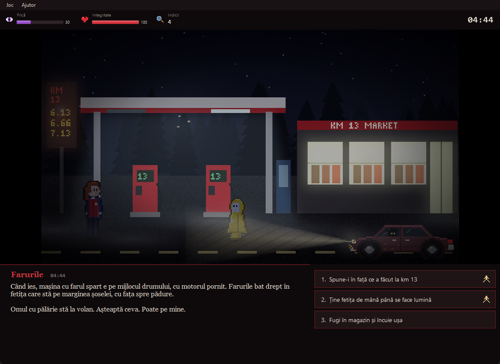
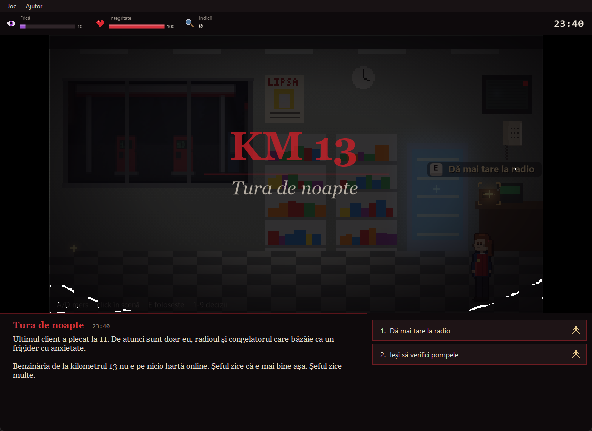

# Review: Last Stop (versiunea 3)

Am verificat jocul după feedback: lucruri pomenite în text care nu existau în scenă, butoanele de interacțiune care apăreau peste scenă și grafica slabă.

Metoda de lucru:
- am citit textul fiecărui bloc din cele 3 povești (70 de blocuri) și l-am comparat cu ce se vede pe ecran;
- am jucat automat câte un drum prin fiecare poveste, cu capturi de ecran la fiecare bloc;
- am verificat din nou toate finalurile cu `StoryCheck`.

---

## 1. Lucruri din text care lipseau din scenă

### KM 13

| Bloc | Ce spunea textul | Ce se vedea | Ce am făcut |
|---|---|---|---|
| `km.hitch` și următoarele 3 | „O mașină veche, cu un far spart, oprește la pompa 2” | Nicio mașină. Mara mergea la x=200 pentru „Uită-te la mașina lui” și se uita în gol. | Mașina e acum desenată și oprită la pompa 2, cu farul aprins și o lumină pe asfalt. „Uită-te la mașina lui” te duce la bara din față, iar acolo se văd bucățile de plastic galben despre care vorbește textul. |
| `km.final` | „Mașina cu farul spart e pe mijlocul drumului... Omul cu pălărie stă la volan” | Nicio mașină. Omul stătea **în picioare**, lângă magazin. | Mașina stă acum pe drum. El e la volan (silueta cu pălărie și ochii aprinși), iar conul farului cade pe fetiță. „Spune-i în față ce a făcut” te duce la geamul șoferului. |
| `km.police` | „Formez” (telefonul de la casă) | În magazin nu exista niciun telefon. | Am pus un telefon pe perete, lângă casă, iar „Sună la poliție” te duce la el. |
| `km.hitch.car` | „Când ridic ochii, el stă chiar în spatele meu” | Omul era departe, la x=176. | Omul stă acum lângă Mara, la mașină. |

### Black Pine: 1987

| Bloc | Ce spunea textul | Ce se vedea | Ce am făcut |
|---|---|---|---|
| `d87.contract`, `d87.fineprint` | „Pe perete nu e încă nicio poză” | Biroul din 2026, cu avizierul plin de poze și rama „Employee of the month”. | Am făcut biroul din 1987 (`office_1987.png`): pereți goi, un calendar din 1987 și un cui gol unde o să stea rama. |
| `d87.photo` | „Ceilalți patru ospătari se aliniază... Locul al treilea din stânga e gol” | Doar proprietarul și Dan. Ospătarii nu existau. | Am pus 4 ospătari palizi, cu ochii pe jumătate închiși, aliniați, cu un loc gol al treilea din stânga. Exact acolo te duce „Zâmbește pentru poză”. |
| `d87.photo` | „Are un aparat foto vechi, cu bliț” | Proprietarul avea mâinile goale. | Proprietarul ține acum un aparat foto cu bliț. „Ia tu aparatul” te duce la el. |
| `d87.photo` | „Dimineața...” | Era noapte, cu lună plină și ploaie. | Scena se petrece acum în parcare, în zori. |
| `d87.shift`, `d87.mirror` | „O pereche care dansează lângă tonomat” și „În geam se văd toți: ... perechea” | Nu era nicio pereche. | Am pus perechea (el cu geacă de piele, ea cu rochie cu buline) lângă tonomat. Se vede și în reflexia din geam. |

### Night Shift

| Bloc | Ce spunea textul | Ce se vedea | Ce am făcut |
|---|---|---|---|
| `intro.counter` | „Pe tejghea e un bilet prins sub o cheie ruginită” | Tejgheaua era goală. | Biletul cu cheia e pe tejghea și te poți uita la el (E). |
| `night1.photo` | „Scotocesc prin dulapul din birou” | Alex stătea lângă calculator. | Alex stă acum lângă dulapul cu dosare. |
| `night3.double` | Două decizii (ușa bucătăriei și pisica) | Aveau hotspot-uri la 4 pixeli una de alta, așa că una o acoperea pe cealaltă. | Ușa e acum sus, pe geamul rotund, iar pisica jos, la podea. |
| `night3.open` | „Recitește dovezile adunate” | Hotspot-ul trimitea personajul la ușa bucătăriei, fără niciun motiv. | E acum o decizie simplă, fără mers. |

---

## 2. Interacțiunile: „apar peste, ar trebui să sugereze”

**Ce nu mergea:**
- **Romburi care pluteau în aer:** romburile galbene stăteau toate la aceeași înălțime, indiferent dacă obiectul era un telefon pe perete, un sertar sau o pisică pe jos.
- **Cruciulițe fixe:** steluțele albastre arătau ca niște cursoare de debug.
- **Cutia „E Calculatorul”:** era o cutie mare, cu ramă, desenată deasupra capului personajului și **peste prim-plan** (vezi monitorul din captura trimisă).
- **Ajutorul permanent:** rândul „A/D mers, click în scenă...” stătea mereu peste partea de jos a scenei.

**Ce face acum** (`Scene.DrawMarkers`, `HudRenderer.DrawHint`):
- **Marcajul stă pe obiect.** Fiecare obiect și fiecare decizie are acum și o înălțime (`y` / `hotspotY`), așa că licărirea apare pe telefon, pe ventilație, pe calendar sau pe pisică, nu în aer.
- **Marcajele sunt discrete:**
  - decizia are un halou cald care respiră;
  - lucrurile de examinat au o sclipire rece care apare și dispare din când în când;
  - fiecare obiect are faza lui, ca să nu clipească toate deodată;
  - după ce te-ai uitat la un obiect, marcajul lui aproape dispare.
- **Când ajungi lângă un obiect,** apar colțuri luminoase în jurul lui și, deasupra lui, o tastă **E** mică, urmată de numele acțiunii. Nu mai e nicio cutie; textul apare lin.
- **Cât timp prim-planul e deschis,** nu se mai desenează niciun marcaj sau indiciu. Primul E închide prim-planul. Prim-planul e acum mai mic (75%), ușor înclinat, iar camera rămâne vizibilă în spate. Se închide singur când pleci de lângă el.
- **Rândul cu tastele** apare doar în primele ~20 de secunde ale poveștii, apoi dispare (F1 îl arată oricând).

---

## 3. Grafica

| Problemă | Ce am făcut |
|---|---|
| **Personajele arătau ca niște dreptunghiuri** decupate, cu un contur negru gros. | Toate personajele sunt redesenate (`tools/art/characters.py`): cap din profil (nas, ureche, sprâncene), brațe care se leagănă invers față de picioare, genunchi la mers, lumină și umbră pe haine, iar conturul e o variantă mai închisă a culorii de lângă el, nu negru. Detalii noi: șorțul și ecusonul lui Alex, vesta Marei, papionul lui Dan, „prea mulți dinți” la clientul fără față, pălăria cu panglică a omului de la km 13. |
| **Personajele erau la fel de luminoase** în parcarea întunecată și în bucătăria cu neon. | Fiecare locație are acum o „lumină pe personaje” (`actorTint`): albastru rece afară noaptea, roz în zori, alb-verzui în magazin, cald în birou. Personajele par acum în scenă, nu lipite peste ea. |
| **Prim-planul cu monitorul** era o cutie bej mare, cu imaginea neclară. | Monitorul CRT e redesenat: carcasă rotunjită, sticlă cu reflexie, zgomot, o bandă de interferență, REC, iar „celălalt Alex” se vede clar cum face cu mâna. |
| **Lipseau obiecte în scene** (vezi secțiunea 1). | Am adăugat obiecte noi, care apar doar în anumite blocuri: mașina (parcată / cu șofer), conul farului, biletul cu cheia, aparatul foto și telefonul de perete. |
| **5 personaje noi** | Patru ospătari din 1987 (pleoape lăsate, papion), perechea care dansează și fetița, redesenată cu cizme, glugă cu lumină și picături. |

Performanță: ~7-8 ms pe cadru (măsurat la rularea automată), la fel ca înainte.

---

## 4. Ce mai rămâne (cunoscut, nerezolvat)

| Prioritate | Problemă | Propunere |
|---|---|---|
| Medie | **Personajele se uită mereu spre jucător,** inclusiv ospătarii care ar trebui să stea cu fața spre aparatul foto. | Un câmp `lookAtPlayer: false` pe personajele din bloc. |
| Medie | **În 1987 nu se vede Dacia roșie** a lui Dan. Mașina din parcare e cea a lui Alex, desenată direct în fundal. | Mașina din fundal devine un obiect separat, ca să poată fi schimbată pe poveste. |
| Mică | **„Camionagii”** e la plural în `d87.shift`, dar în sală e unul singur. | Încă un client sau textul la singular. |
| Mică | **Prim-planul e scalat la 75%,** deci pixelii lui nu sunt perfect egali. | Prim-planuri desenate direct la 120×90. |
| Mică | **Personajele nu au cadre din față.** La poză toată lumea stă din profil. | Un cadru „spre cameră” în spritesheet. |
| Mică | **Fără sunet** (limitare WinForms, documentată în PLAN.md). | `NAudio` sau `System.Media.SoundPlayer` pentru efecte simple. |

## 5. Verificare

- Build: 0 erori, 0 avertismente.
- `StoryCheck`: toate cele 15 finaluri sunt accesibile, toate blocurile sunt atinse, nu există fundături și nici simboluri ciudate în texte.
- Editor `--selftest`: 102 noduri vizitate, povestea rămâne neschimbată, 0 probleme de validare. Câmpurile noi (Y pentru obiecte și decizii) se văd și se editează în tabele, iar obiectele din bloc apar în previzualizare.
- Rulări automate cu capturi: KM 13 până la finalul cu mașina, 1987 până la „Noul proprietar”, Night Shift până la monitorul din birou.
- **Netestat de mine:** jocul manual de la tastatură, în special felul în care se simt marcajele și indiciul E când te plimbi liber prin scenă.
